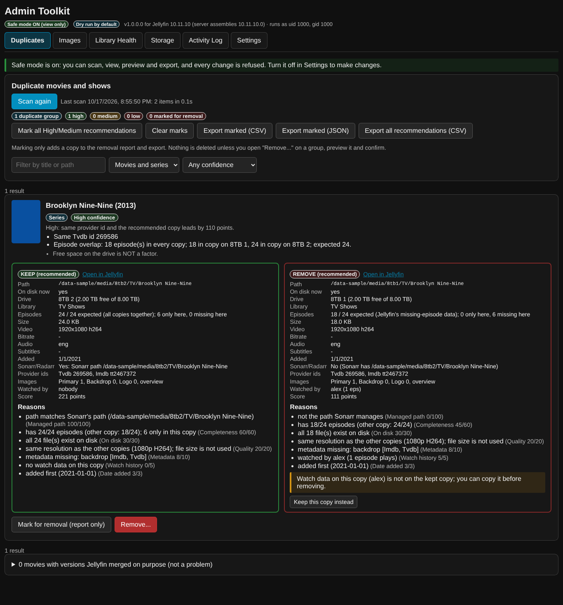
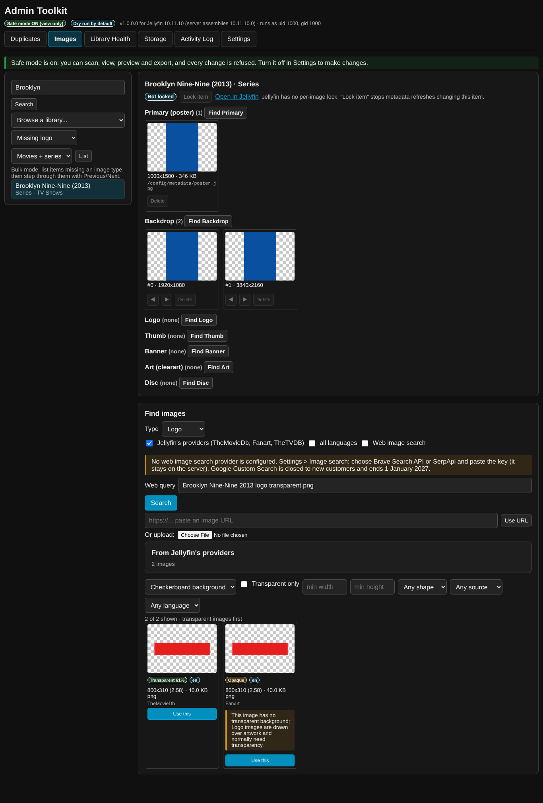

# Admin Toolkit for Jellyfin

An admin-only Dashboard page for Jellyfin **10.11.10** with six tabs: **Duplicates | Images | Library Health | Storage | Activity Log | Settings**.

The plugin is read-only by default: **safe mode is on for a new install**, and dry run is the default for every removal. Nothing destructive happens without a preview and an explicit confirmation.

* **No home-screen footprint.** The plugin is one Dashboard page in the sidebar (`IHasWebPages`, `EnableInMainMenu`). It does not inject into `index.html` and does not write into Custom Tabs, Home Screen Sections or any other plugin. It does not need File Transformation, JavaScript Injector or Plugin Pages.
* **No side effects at start-up.** Nothing scans or writes until you click a button. The optional scheduled task has no trigger and also needs a Settings switch.
* **Built for exactly Jellyfin 10.11.10**, and CI checks it binds against 10.11.10 (see [docs/DESIGN.md](docs/DESIGN.md)).



## Install

1. Dashboard → **Plugins** → **Repositories** (the "Manage repositories" button in 10.11) → **+**. Use any name, and this URL:

   ```
   https://raw.githubusercontent.com/alexgirollet-blip/Jellyfin-admin-toolkit-plugin/main/manifest.json
   ```

2. Dashboard → **Plugins** → **Catalog** → **Admin Toolkit** → Install (version 1.0.0.0, target ABI 10.11.10.0).
3. Restart Jellyfin (in the linuxserver container: restart the container).
4. Open **Admin Toolkit** in the Dashboard sidebar.

> The manifest gets its `versions` entry (sourceUrl, MD5 checksum, targetAbi, changelog, timestamp) from the release workflow. After merging to `main`, go to **Actions → Release → Run workflow** and enter `1.0.0.0` (or push a tag `v1.0.0.0`). The workflow builds, tests, checks binary compatibility, zips, publishes the release, updates `manifest.json` on `main`, then downloads the zip again to verify the checksum. Until the first release, `manifest.json` is `[]` and the catalogue shows nothing.

### Uninstall

Dashboard → Plugins → Admin Toolkit → Uninstall, then restart. Admin Toolkit deletes its own data folder (`/config/data/admintoolkit`: scan cache and activity log). Jellyfin removes the plugin folder and its settings XML. Nothing else is left anywhere, because the plugin never writes outside those places. The only exceptions are files you asked it to change: images you set, `.ignore` files you chose to write, and media you deleted.

## Safe mode

* **On (default):** you can scan, view, preview, export and run dry runs. The **server** refuses every change with HTTP 403 "Safe mode is on", not just the UI. That covers removals, image changes, lock/unlock, metadata refreshes and library rescans.
* **Off:** changes are allowed, still with a preview and confirmation each time. Deleting files additionally needs you to type `DELETE`; this can be relaxed in Settings to "dialog only".
* Every action is recorded in the **Activity Log** with time, admin, target, result and details.

## Tabs

### Duplicates
The scan groups movies and series by signal, strongest first:

1. The same TMDb/TVDb/IMDb id, including ids in folder names like `[tmdbid-603]`.
2. The same normalised title and year, as long as the provider ids don't conflict. These groups are marked as at most Medium confidence.
3. For series, an episode-by-episode comparison: how many episodes each copy shares, has only itself, or is missing.

It also lists movies Jellyfin merged as versions on purpose (informational), duplicate episodes inside one series (optional), and copies that point at the same files.

Each copy shows:
* path, drive (with free and total space), library, on-disk status, file and episode counts
* size, resolution, codec, HDR, bitrate, audio and subtitle languages
* date added, Sonarr/Radarr management (and the path Sonarr/Radarr has)
* provider ids, images and overview, and who watched it

**Score and reasons.** Each copy gets points from each signal, and each signal adds a plain-English reason. The defaults are below and every weight is adjustable:

| Signal | Points |
| --- | --- |
| Path managed by Sonarr/Radarr | 100 |
| Completeness | 60 |
| On disk | 30 |
| Resolution | 20 |
| Metadata | 10 |
| Watch history | 5 |
| Date added | 3 |
| Preferred drive | 5 |

File size is not used, and free space is never a factor. Confidence is High, Medium or Low. **Low groups are never pre-selected**, and the UI shows why. "Keep this copy instead" swaps the decision in one click and re-evaluates the warnings.

**Actions:**
* **Mark for removal (report only)** and **Export CSV/JSON**: nothing is deleted.
* **Remove...**: opens a dialog with options, then **Preview**, which shows exactly what will happen and the space freed. **Dry run** is ticked by default.
  * A copy that Sonarr/Radarr manages is deleted through their API (`DELETE /api/v3/series/{id}?deleteFiles=true&addImportListExclusion=false`, or the movie equivalent). The dialog warns that Sonarr/Radarr will stop tracking it.
  * An unmanaged copy (the usual stale duplicate) is removed from the Jellyfin library. It can also have its files deleted, with an extra confirmation, but only after a write-permission check on the exact paths.
  * If Jellyfin cannot write there, you get the path, the reason and a copy-ready command such as `docker exec -u 0 'jellyfin' rm -r -- '/data/...'`. The plugin never suggests changing PUID/PGID, mounts or ownership.
  * **Library only (keep files)** can also write a `.ignore` file so the next scan doesn't add the copy back (Jellyfin 10.11 honours `.ignore`).
  * **Copy watch data first** is on by default. It copies played state, play count, favourite and resume position to the kept copy wherever the kept copy has none; for series, episodes are matched by season/episode.

### Images
* **Find an item:** search by title (movies, series, seasons, episodes, collections, people), browse a library, or use bulk mode ("missing logo/backdrop/poster" with Previous/Next).
* **Current images:** every type (Primary, Backdrop with order, Logo, Thumb, Banner, Art, Disc) with dimensions and file size. You can delete an image or reorder backdrops.
* **Find images from:**
  * Jellyfin's own providers (TMDb, Fanart.tv, TheTVDB… via `GetAvailableRemoteImages`), shown first
  * web image search (Brave Search API or SerpApi)
  * a pasted URL or an upload
* **Transparency:** the server downloads each candidate safely and decodes it. **Transparent** means pixels really have alpha below 250; a PNG/WebP with an unused alpha channel shows **Opaque**.
* **Browsing results:** preview on checkerboard, dark or light backgrounds. Filter by transparent only, minimum size, shape, source or language. For logo, clearart and disc art, transparent images are sorted first. You get warnings for the wrong aspect ratio, low resolution, or an opaque logo.
* **Apply:** shows a before/after preview first. Images are saved through `IProviderManager.SaveImage`, the same way Jellyfin's own upload stores them. You can choose to **lock the item** afterwards. Jellyfin 10.11 has no per-image lock, so this sets the item's lock, which stops metadata refreshes changing it.



### Library Health
**Checks:**
* Library folders that are missing or empty (drive not mounted), plus readable and writable status for each folder.
* Ghost items (the file is gone). These are grouped under an unreachable drive rather than listed thousands of times.
* No provider ids, few episodes compared with provider data, missing seasons or episodes.
* Missing poster, backdrop, logo, overview or year.
* Folder naming problems.
* Subtitle and audio language audit (language set in Settings).
* Low resolution, old codecs, very high bitrate, and HEVC 10-bit/HDR/DV/AV1 that may not direct play (informational only).
* Empty folders and leftover files (`.part`, `.!qb`, samples…), reported only.

**Actions:** "Open in Jellyfin", "Images", **Refresh metadata** for selected items, and **Rescan library**.

### Storage
* Each named drive with a used/free bar.
* Size per library and per drive, and the largest titles. Sort by size, last watched, play count or date added.
* **Not watched by anyone in X months**, largest first, with CSV export.
* Click through to an item's duplicate group or its images.

### Activity Log
Every scan, removal, image change and settings change, with filters, CSV export and a retention setting. API keys are never logged.

### Settings
* **Sonarr, Radarr, Jellyseerr:** URL and API key, with **Test connection**. Keys are stored server-side and shown as `••••1234`; saving the mask keeps the stored key.
* **Sonarr/Radarr path mappings:** for example, Sonarr's `/tv` = Jellyfin's `/data/tvshows`. Without these, "managed by Sonarr" can't be detected when the containers mount differently.
* **Image search provider and key**, with **Test search**.
* **Drives:** name them by path prefix (longest prefix wins), for example `/data/media1 → 8TB 1`. Each row has **Check write access** (writes nothing) and **Test write**, which creates and deletes an empty hidden file. You can also set an optional preferred drive and the container name used in copy-ready commands.
* **Scoring weights and thresholds**, with Reset to defaults.
* **Safe mode, dry-run default and confirmation level.**
* **Allow scheduled scans:** see below.
* **Audit languages, high-bitrate threshold, "not watched" period and log retention.**
* **Self-check:** runs every Jellyfin API the plugin uses on your server and shows what works, with "Copy diagnostics".

Scheduled scans: the task **"Admin Toolkit: scan duplicates and library health"** appears under Dashboard → Scheduled Tasks with no trigger. It runs only if you add a trigger there **and** tick "Allow scheduled scans". It only scans and caches results.

## Errors and diagnostics
Every section loads on its own (`Promise.allSettled`). A failure shows the real message, the endpoint and the HTTP status, for example `HTTP 500 GET /AdminToolkit/Storage/Drives (jellyfin_api_error)`, with **Retry** and **Copy diagnostics**. Every Jellyfin call goes through a small adapter layer. If your server's Jellyfin version doesn't match, you see a readable message such as "This Admin Toolkit build (made for Jellyfin 10.11.10) does not match… MissingMethodException: …" instead of a crash or a bare 500.

## Image search providers (researched October 2026)
| Provider | Status | Notes |
| --- | --- | --- |
| Google Custom Search JSON API | **Closed to new customers**; Google ends it for existing customers on **1 January 2027** | Supported only as "legacy" for existing keys (needs the `cx` engine id too) |
| Brave Search API (images endpoint) | Available, paid per 1,000 requests with monthly credits | `GET https://api.search.brave.com/res/v1/images/search`, `X-Subscription-Token` header |
| SerpApi (Google Images engine) | Available, paid with a small free plan | `GET https://serpapi.com/search.json?engine=google_images` |

Bing's image search API was retired by Microsoft in 2025, so it isn't offered. Keys are used only by the server and never reach the browser.

## Manual test checklist (safest first)
Some things can only be tested on your server, Sonarr/Radarr and drives (see Known limitations). Go in this order:

1. **Install and look.** Install, restart, open Admin Toolkit.
   * The status bar shows "Safe mode ON" and "for Jellyfin 10.11.10 (server assemblies 10.11.10.x)".
   * The home screen, Custom Tabs, Home Screen Sections and Media Bar are unchanged.
2. **Self-check.** Settings → Self-check: every line is green. If a line is red, use Copy diagnostics and send it to me.
3. **Drives.** In Settings → Drives, add your prefixes (as Jellyfin sees them, e.g. `/data/...`) → "8TB 1", "8TB 2", "1TB". Save. Then:
   * Click **Check write access** on each. This writes nothing; it tells you whether user `abc` can write there.
   * Storage → Drives should show sizes matching the drives.
4. **Sonarr/Radarr.**
   * Enter the URL and key, then **Test connection** on each. You should see "Connected: Sonarr 4.x".
   * Add path mappings if Sonarr's paths differ from Jellyfin's.
5. **Library Health scan** (read-only). Check:
   * unmounted drives show as "Empty… probably not mounted"
   * a few ghost items or missing logos look right
6. **Duplicate scan** (read-only). Find the show you moved between drives and check:
   * the copy on the drive Sonarr uses is **KEEP (recommended)**
   * "path matches Sonarr's path" appears
   * the episode counts and overlap are right
   * the Watched-by names are right
7. **Report only.** Mark a few groups → Export CSV. Open the CSV and check the paths and sizes. Nothing on disk changed.
8. **Dry run.** On one group, Remove… → Preview → Run dry run. Check:
   * the steps make sense
   * the Activity Log has a DryRun entry
   * nothing changed
9. **Storage scan** (read-only). Check the largest titles and the "not watched in 12 months" list.
10. **One image change.**
    * Settings → turn safe mode **off** → Save.
    * Images → search a throwaway movie → Find Logo → Jellyfin providers.
    * Check the **Transparent/Opaque** badges on a checkerboard background.
    * Apply one logo (before/after shown).
    * Check it in Jellyfin's item page, then delete it again from the Images tab if you like.
11. **One removal on a throwaway item.** Make a test duplicate, e.g. copy a small movie folder to another library folder and scan the library. Then:
    * Duplicate scan, then Remove… with **"Remove from Jellyfin library only"** and dry run unticked. Confirm. The item leaves Jellyfin; the files stay.
    * Next, on another throwaway duplicate, tick "Also delete the files…": the preview checks permissions first.
      * If it's writable, type DELETE and run.
      * If it isn't writable, the preview shows the reason and a command to run yourself.
12. **Through Sonarr/Radarr** (riskiest). Only with a title you don't mind Sonarr forgetting:
    * choose to keep the *unmanaged* copy (override)
    * Remove… shows "Delete … in Sonarr with its files"
    * run it, then check Sonarr
13. Turn **safe mode back on** when you're done.

## Known limitations and what is untested
* **Tested here:** 154 unit tests, including fake Jellyfin adapters with real temp folders, a fake Sonarr, and a local HTTP server for the SSRF guard. Also a headless-Chromium test of the page against API responses generated by the real services. The binary check JIT-compiles every method against the real Jellyfin 10.11.10 assemblies.
* **Not tested (no live server available):**
  * the plugin loading inside a running Jellyfin 10.11.10
  * the page inside the real dashboard (it follows the same pattern as Media Vote's working page)
  * real Sonarr/Radarr/Jellyseerr, real TMDb/Fanart remote images, real Brave/SerpApi responses (the parsers follow their documentation)
  * your drives, Docker mounts and the `abc` user
  * the read-only-folder test runs only in CI (it's skipped as root)
* **Scan time:** the storage and health scans read play data and media streams for every episode. On large libraries they can take several minutes; they run in the background with progress shown.
* **Expected episode counts** come from Jellyfin's "missing episode" records, when your metadata providers create them. Otherwise "expected" means "all copies together".
* **Jellyfin "delete media"** removes the movie's whole folder when the movie has its own folder. That's why the preview lists the exact folders.
* **Image lock:** Jellyfin has no per-image lock, so the plugin locks the whole item.
* **Managed path detection** compares paths exactly, after path mapping, and is case-sensitive.
* **Image fetching:** server-side fetches don't use an HTTP proxy, on purpose (a proxy would bypass the address checks). If your server can only reach the internet through a proxy, web image search will fail.

## Sources
* Jellyfin plugin template: <https://github.com/jellyfin/jellyfin-plugin-template>. API signatures were read by reflection from the `Jellyfin.Controller`/`Jellyfin.Model` **10.11.10** NuGet packages.
* Jellyfin 10.11.10 source:
  * SkiaSharp 3.116.1 in `Directory.Packages.props`
  * plugin loading in `Emby.Server.Implementations/Plugins/PluginLoadContext.cs`
  * `.ignore` support in `Emby.Server.Implementations/Library/DotIgnoreIgnoreRule.cs`
  * all at <https://github.com/jellyfin/jellyfin/tree/v10.11.10>
* Sonarr v3 API: OpenAPI spec at <https://github.com/Sonarr/Sonarr/blob/v4.0.15.2941/src/Sonarr.Api.V3/openapi.json> (`/api/v3/series`, `DELETE /api/v3/series/{id}?deleteFiles&addImportListExclusion`, `X-Api-Key`).
* Radarr v3 API: OpenAPI spec at <https://github.com/Radarr/Radarr/blob/develop/src/Radarr.Api.V3/openapi.json> (`/api/v3/movie`, `DELETE /api/v3/movie/{id}?deleteFiles&addImportExclusion`).
* Google Custom Search JSON API closure: <https://developers.google.com/custom-search/v1/overview> and migration notes such as <https://dev.to/rbatista19/what-should-i-migrate-to-now-that-googles-custom-search-json-api-is-retiring-3hgk>.
* Brave Search API image search: <https://api-dashboard.search.brave.com/app/documentation/image-search/responses>, <https://brave.com/search/api/>.
* SerpApi Google Images: <https://serpapi.com/google-images-api>, <https://serpapi.com/blog/how-to-scrape-google-images-results/>.

## Development
```
dotnet test Jellyfin.Plugin.AdminToolkit.sln -c Release
python3 .github/scripts/check_versions.py
dotnet build tools/ApiCompat -c Release -p:JellyfinVersion=10.11.10
dotnet tools/ApiCompat/bin/Release/net9.0/ApiCompat.dll src/Jellyfin.Plugin.AdminToolkit/bin/Release/net9.0/Jellyfin.Plugin.AdminToolkit.dll
ADMIN_TOOLKIT_SAMPLE_OUT=$PWD/tests/client/fixtures/api-sample.json dotnet test -c Release --filter ApiSampleExport
node tests/client/admin-smoke.js    # needs playwright; SCREENSHOTS=docs/screenshots to refresh screenshots
```
